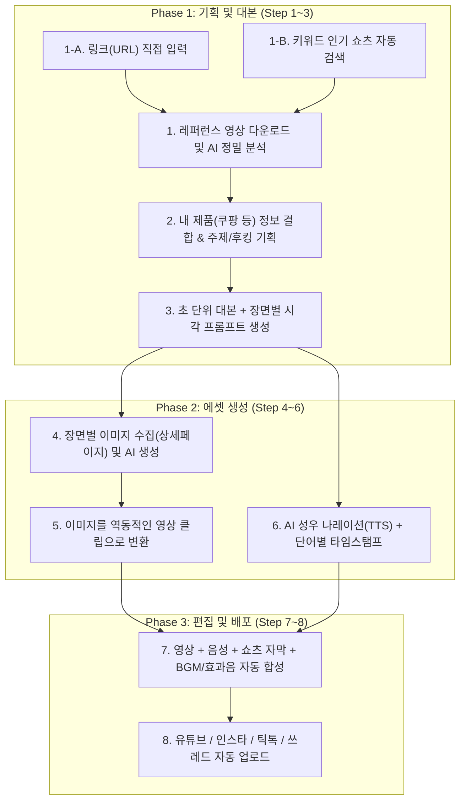

# 🎬 쇼츠 광고 제작 및 업로드 자동화 마스터 플랜

사용자님의 요구사항(**① 쿠팡 및 다양한 제품 홍보**, **② 링크 입력 + 키워드 자동 검색 병행**, **③ 초기 비용 최소화 후 점진적 퀄리티 업그레이드**)을 반영한 전체 설계도입니다.

---

## 🏗️ 1. 전체 파이프라인 구조 (모듈형 8단계)

각 단계는 독립된 폴더와 데이터 파일(`JSON`, `MP4`, `MP3`, `PNG`)로 연결되어, **언제든 특정 단계만 수정하거나 재실행**할 수 있습니다.



---

## 💰 2. 비용 최소화(초기) ➔ 고퀄리티(확장) 단계별 기술 스택

초기에는 **무료 또는 사실상 0원에 가까운 도구**들로 1~8단계를 완성하고, 이후 설정만 바꿔 유료 고성능 AI를 붙일 수 있도록 플러그인 형태로 제작합니다.

| 단계 | 🟢 초기 버전 (최소 비용 / 무료 위주) | 🔵 확장 버전 (퀄리티 업그레이드 시) |
| :--- | :--- | :--- |
| **1. 영상 수집/분석** | • 수집: `yt-dlp` (링크 다운로드 + 키워드 검색 무료)<br>• 분석: **Google Gemini API (무료 티어 제공)** | • 틱톡/인스타 전문 스크래퍼 연동<br>• 대량 분석 파이프라인 |
| **2. 주제 정하기** | • 쿠팡 상품 URL/특징 입력 + Gemini AI 기획안 도출 | • 트렌드 키워드 자동 크롤링 결합 |
| **3. 대본 작성** | • Gemini 2.5 Flash/Pro 기반 후킹 대본 생성 | • Claude 3.7 Sonnet (카피라이팅 특화) 연동 |
| **4. 이미지 준비** | • **쿠팡/제품 실제 이미지 자동 추출** + **무료 AI 이미지 생성** (Pollinations / Imagen 무료 한도 등) | • Flux.1 Pro, Midjourney, 실사 합성 AI |
| **5. 영상화 (I2V)** | • **다이내믹 모션 엔진 (무료)**: 줌인/아웃, 화면 흔들림, 슬라이드, 패닝 등 역동적 카메라 무빙 자동 적용 | • Kling, Hailuo, Runway 등 AI 비디오 생성 API (초반 3초 후킹 장면에만 하이브리드 적용 가능) |
| **6. 나레이션** | • **Edge-TTS (완전 무료)**: 쇼츠 인기 한국어 음성(`선희`, `인준` 등) + 자막 싱크 데이터 자동 추출 | • ElevenLabs, 타입캐스트(Typecast) 감정 연기 음성 |
| **7. 영상 편집** | • **FFmpeg + Python (무료)**: 쇼츠풍 강조 자막, 효과음(휙, 띠링 등), BGM 자동 믹싱 렌더링 | • 캡컷(CapCut) 초안 파일 자동 생성 기능 추가 |
| **8. 멀티 업로드** | • **Playwright 브라우저 자동화 (무료)**: 내 PC 크롬 로그인 세션을 활용해 4대 플랫폼 자동 업로드 | • 공식 API 연동 및 다계정 스케줄러 탑재 |

---

## 📂 3. 작업 폴더(`d:\자동화`) 구조 설계

관리하기 쉽고 깔끔하게 아래와 같은 폴더 구조로 프로젝트를 세팅합니다.

```text
d:\자동화\
 ├── config\              # API 키, 기본 설정(자막 폰트, 목소리 종류 등)
 ├── modules\             # 1~8단계 핵심 모듈 코드
 │    ├── step1_analyzer.py      # 1단계: 영상 수집 및 AI 분석
 │    ├── step2_planner.py       # 2단계: 제품 매칭 및 주제 기획
 │    ├── step3_scripter.py      # 3단계: 대본 및 스토리보드 작성
 │    ├── step4_5_visuals.py     # 4~5단계: 이미지 생성 및 모션 영상화
 │    ├── step6_tts.py           # 6단계: 나레이션 및 자막 싱크 생성
 │    ├── step7_editor.py        # 7단계: 최종 영상 렌더링
 │    └── step8_uploader.py      # 8단계: 멀티 플랫폼 자동 업로드
 ├── workspace\           # 프로젝트별 작업 결과물이 저장되는 곳 (중간 검수 가능!)
 │    └── project_001\
 │         ├── 1_reference\      # 다운받은 레퍼런스 영상 및 AI 분석 리포트(json/md)
 │         ├── 2_3_script\       # 기획안 및 최종 대본(스토리보드)
 │         ├── 4_5_visuals\      # 생성된 이미지 및 영상 클립들
 │         ├── 6_audio\          # 나레이션 mp3 및 자막 파일(srt/json)
 │         └── 7_output\         # 최종 완성된 쇼츠 영상 (.mp4)
 └── app.py               # 내가 편하게 버튼으로 조작할 수 있는 화면(UI) 또는 통합 실행기
```

---

## 🚀 4. 첫 번째 개발 목표: [Step 1. 영상 분석기] 제작

가장 먼저 **1단계(영상 수집 및 분석기)**를 만들고 직접 돌려보면서 조율하겠습니다.

1. **기능**:
   - 유튜브 쇼츠/틱톡/인스타 **URL을 넣거나**, `"자취 꿀템"`, `"쿠팡 추천템"` 같은 **키워드를 입력**하면 영상을 자동으로 가져옵니다.
   - AI가 영상을 프레임 단위로 보고 **[① 초반 3초 후킹 기법, ② 대본 전체 원문, ③ 초 단위 화면 전환 구조, ④ 셀링 포인트(구매 유도 방식)]**를 깔끔한 리포트로 뽑아줍니다.
2. **필요한 준비물**:
   - 무료로 영상을 보고 분석할 수 있는 **Google Gemini API 키** (무료 발급 가능, 없으시면 발급 방법을 1분 만에 안내해 드립니다.)
